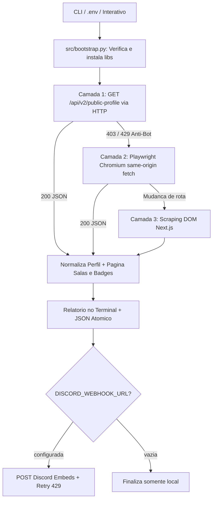

# 👻 THM Specter Tracker — Extrator de Perfil TryHackMe para Discord
<p align="center">
  
  <a href="https://github.com/panda12332145/THM-Specter-Tracker---ferramenta-que-extrai-perfil-do-THM-e-envia-para-um-wmbed-discord/commits/main"></a>
  <a href="https://github.com/panda12332145/THM-Specter-Tracker---ferramenta-que-extrai-perfil-do-THM-e-envia-para-um-wmbed-discord"></a>
  
</p>
---
> ⚠️ **Nota de Segurança / Uso Ético:** esta ferramenta consulta **exclusivamente dados públicos** de perfis do TryHackMe. O envio ao Discord é opcional e configurado via `.env`, variável de ambiente `DISCORD_WEBHOOK_URL` ou flag `--webhook` — nenhuma URL de webhook fica hardcoded no repositório.

---
## 🔖 Resumo

**THM Specter Tracker** é uma ferramenta em Python que extrai automaticamente os dados públicos de qualquer perfil do **TryHackMe** (nível, ranking global e percentil, pontos, liga, streak, capability score, salas concluídas com dificuldade/link e badges com raridade), salva o relatório de forma atômica em `tryhackme_profile.json` e envia um painel rico com **3 Embeds formatados para um canal do Discord via Webhook**.

Conta com **auto-instalação de dependências** (`pip` + binário Chromium sob demanda) e **arquitetura de coleta em 3 camadas**, eliminando quebras por mudanças de layout no frontend do TryHackMe ou bloqueios anti-bot.

### ✨ Funcionalidades Principais

- ✅ **Auto-bootstrap de dependências** — verifica e instala `requests`, `playwright` e o navegador `chromium` automaticamente caso ausentes (compatível com Windows `py -3.14`, venv e Linux PEP 668)
- ✅ **Coleta resiliente em 3 camadas** — API Pública v2 via HTTP direto → API v2 dentro do contexto real do Chromium (contorna HTTP 429/403 anti-bot) → Extração direta do novo DOM Next.js
- ✅ **Paginação completa** — coleta salas concluídas (com dificuldade e URL direta) e badges (com tier e percentual de raridade)
- ✅ **Embeds validados para Discord** — 3 cartões ricos (Perfil, Salas Concluídas e Badges) respeitando limites de caracteres, campos seguros e retry automático em `HTTP 429`
- ✅ **Persistência JSON atômica** — gravação via arquivo temporário + `os.replace` em UTF-8 (nunca corrompe `tryhackme_profile.json`)
- ✅ **CLI completa + Modo Interativo + `.env`** — funciona tanto passando flags quanto clicando/executando direto no terminal

## 📽 Demonstração

```text
$ python main.py -u CyberOwl
[INFO] Coletando perfil público do TryHackMe: 'CyberOwl'...

==========================================================
  👻 THM SPECTER TRACKER — CyberOwl
==========================================================
  📡 Fonte de coleta : API Pública v2 (HTTP direto)
  🔗 Perfil          : https://tryhackme.com/p/CyberOwl
  🎚️  Level           : 21
  🏆 Rank            : #11 (Top 1%)
  ⭐ Pontos          : 201,226
  💎 Liga            : Ruby
  🔥 Streak          : 707 days (Max: 719)
  🚪 Salas (total)   : 1331 (listadas: 500)
  🏅 Badges (total)  : 113 (listados: 113)
  ⚡ Capability      : 109.05 (purple)
  🏁 Primeiras salas : Crack the hash, Mr Robot CTF, Jurassic Park, Pickle Rick, ToolsRus ... (+495)
  🎖️  Primeiros badges: cat linux.txt, Webbed, Burp'ed, Metasploitable, Blue ... (+108)
==========================================================
[OK] Dados salvos com sucesso em: .../tryhackme_profile.json
[OK] Embed enviado ao Discord com sucesso (HTTP 204)!
[OK] Execução concluída com sucesso!
```

## ⚙️ Explicação das Partes Importantes

### Coleta em 3 camadas (`src/collector.py`)

```python
# Camada 1: API oficial v2 via requests.Session (rápida, ~1s)
transport = RequestsTransport(username=username)
collected = collect_via_api_transport(transport.fetch_json, username=username)

# Camada 2/3: Fallback automático via Playwright Chromium se houver desafio 403/429
collected, source = collect_via_browser(username=username, headless=headless)
```

> O script legado quebrava com `TimeoutError` esperando `[data-sentry-element='StyledStatisticBox']` porque o TryHackMe migrou seu frontend para Next.js e removeu os atributos do Sentry e as abas `?tab=badges`. Agora a coleta usa a API v2 oficial paginada com fallback automático para navegador e para o novo DOM Next.js.

### Auto-instalação de dependências (`src/bootstrap.py`)

```python
missing = [(mod, spec) for mod, spec in packages if importlib.util.find_spec(mod) is None]
# Instala via sys.executable -m pip install (suporta venv, Windows e PEP 668 no Linux)
# e atualiza site.getusersitepackages() + importlib.invalidate_caches() no mesmo processo
```

> Nenhuma biblioteca precisa estar pré-instalada: na primeira execução o próprio script baixa `requests`/`playwright` e, caso o fallback de navegador seja acionado sem o Chromium instalado, executa `playwright install chromium` automaticamente.

### Proteção contra `KeyError` e validação de Embeds (`src/discord_webhook.py`)

```python
profile = data.get("profile")
if not isinstance(profile, dict) or not str(profile.get("username") or "").strip():
    raise ValueError("Perfil vazio ou sem 'username' — coleta não foi concluída.")

if _is_http_url(avatar):
    profile_embed["thumbnail"] = {"url": avatar}  # nunca envia thumbnail: {}
```

> Corrige os dois bugs secundários do script original: evita `KeyError: 'username'` caso a coleta falhe e nunca envia `"thumbnail": {}` (que causava `HTTP 400 Bad Request` na API do Discord quando o usuário não possuía avatar).

## 🔄 Fluxo de Trabalho / Arquitetura



## 📂 Estrutura do Projeto

```plaintext
THM-Specter-Tracker---ferramenta-que-extrai-perfil-do-THM-e-envia-para-um-wmbed-discord/
├── main.py                  # Ponto de entrada principal (CLI + modo interativo)
├── THM Specter Tracker - ferramenta que extrai perfil do THM e envia para um wmbed discord.py  # Wrapper compatível com o script original
├── src/
│   ├── __init__.py
│   ├── bootstrap.py         # Auto-instalação de pacotes pip e Chromium
│   ├── config.py            # Parser CLI, .env, variáveis de ambiente e sanitização
│   ├── collector.py         # Coletor em 3 camadas (API HTTP, API Browser, DOM Next.js)
│   ├── discord_webhook.py   # Montagem validada dos 3 Embeds e envio ao Discord
│   ├── storage.py           # Persistência JSON atômica (tmp + os.replace)
│   └── main.py              # Orquestração e relatório visual no terminal
├── tests/
│   └── test_tracker.py      # 14 testes automatizados (100% offline com mocks)
├── .env.example             # Exemplo de configuração sem credenciais expostas
├── .gitignore
├── CHANGELOG.md
├── requirements.txt
└── README.md
```

## 🛠️ Tecnologias

| Ferramenta | Uso |
|---|---|
| **Python 3.10+** | Linguagem principal (testado até Python 3.14) |
| **requests** | Consumo rápido e paginado da API pública v2 do TryHackMe e envio ao Discord |
| **Playwright (Chromium)** | Fallback automático para contornar proteção anti-bot (Vercel/Cloudflare) e extração DOM |
| **Discord Webhooks** | Entrega de relatórios ricos em Embeds |
| **unittest / MagicMock** | Suite de testes automatizados sem dependência de rede |

## ▶️ Instalação

```bash
git clone https://github.com/panda12332145/THM-Specter-Tracker---ferramenta-que-extrai-perfil-do-THM-e-envia-para-um-wmbed-discord.git
cd THM-Specter-Tracker---ferramenta-que-extrai-perfil-do-THM-e-envia-para-um-wmbed-discord

# Opcional — o próprio script já instala automaticamente na primeira execução!
pip install -r requirements.txt

# Configure suas variáveis (opcional):
cp .env.example .env
# Edite .env com seu THM_USERNAME e DISCORD_WEBHOOK_URL
```

## 🚀 Execução

```bash
# Modo simples / interativo (instala dependências automaticamente se faltarem):
python main.py

# Ou usando o arquivo com o nome original no Windows (Python 3.14):
py -3.14 "THM Specter Tracker - ferramenta que extrai perfil do THM e envia para um wmbed discord.py"

# Modo direto via argumentos de linha de comando:
python main.py --username CyberOwl --webhook "https://discord.com/api/webhooks/ID/TOKEN"

# Apenas salvar JSON local e exibir no terminal (sem enviar ao Discord):
python main.py --username CyberOwl --no-webhook

# Forçar coleta via navegador Playwright (útil se o IP sofrer rate-limit HTTP):
python main.py --username CyberOwl --browser
```

## 🧪 Testes

14 testes automatizados cobrindo normalização e sanitização de username, leitura de `.env`, parsing completo da API v2 do TryHackMe, paginação de salas e badges, fallback automático de HTTP `429` para Playwright, scraping do novo DOM Next.js, proteção contra `KeyError`, limites de caracteres do Discord, retry em `429` e escrita JSON atômica:

```bash
python tests/test_tracker.py
```

## ⚠️ Limitações

- Perfis configurados como **privados** no TryHackMe (`isPrivateProfile: true`) não expõem lista pública de salas concluídas nem badges.
- O username do TryHackMe é **case-sensitive** (deve corresponder exatamente ao final da URL `https://tryhackme.com/p/<username>`).
- Os Embeds do Discord exibem até 25 salas e 25 badges no resumo visual (o arquivo `tryhackme_profile.json` armazena toda a lista coletada).

## 🚀 Roadmap

- [ ] Modo monitoramento agendado (notificar apenas novas salas/badges conquistados)
- [ ] Comparação entre múltiplos perfis (leaderboard de equipe no Discord)
- [ ] Exportação adicional em Markdown/HTML

## 📄 Licença

Todos os direitos reservados ao autor.

---

## 👾 Autor

<p align="center">
  
</p>

<p align="center">Feito por <strong>Panda12332145</strong> 👋🏽</p>

---

## 🧑‍💻 Sobre Mim

Sou apaixonado por **Física Teórica, Cibersegurança e Desenvolvimento de Sistemas**. Tenho grande interesse em programação de baixo nível, engenharia reversa, automação, sistemas Windows, criptografia e segurança ofensiva. Também gosto bastante de música, filosofia e computação avançada.

---

## 🌐 Redes

* **Site:** [https://panda-h0me.netlify.app/](https://panda-h0me.netlify.app/)
* **YouTube:** [https://www.youtube.com/@X86BinaryGhost](https://www.youtube.com/@X86BinaryGhost)
* **Instagram:** [https://www.instagram.com/01pandal10/](https://www.instagram.com/01pandal10/)
* **GitHub:** [https://github.com/panda12332145](https://github.com/panda12332145)
* **LinkedIn:** [linkedin.com/in/athos-da-boanergis](https://www.linkedin.com/in/athos-d%C3%A3-boanergis-5585a4288/)

---

## 🚀 Áreas de Interesse

* **Cibersegurança Avançada** 🔒
* **Hacking & Engenharia Reversa** 💻
* **Computação de Baixo Nível** 🖥️
* **Matemática e Física Teórica** 📐⚛️
* **Desenvolvimento de Ferramentas de Segurança** 🛠️

_"Conhecimento é poder, e domínio técnico vem da compreensão profunda dos sistemas."_

---

## 📞 Contato & Suporte

Para colaborações, dúvidas ou sugestões:

📧 **E-mail:** [athos.cybersec@gmail.com](mailto:athos.cybersec@gmail.com)

🐛 **Reportar Bug:** [Abrir Issue](https://github.com/panda12332145/THM-Specter-Tracker---ferramenta-que-extrai-perfil-do-THM-e-envia-para-um-wmbed-discord/issues)

💡 **Sugerir Melhoria:** [Discussions](https://github.com/panda12332145/THM-Specter-Tracker---ferramenta-que-extrai-perfil-do-THM-e-envia-para-um-wmbed-discord/discussions)

## 📊 Métricas

<!-- metrics:start -->
| Métrica | Valor |
|---|---|
| ⭐ Stars | 0 |
| 🍴 Forks | 0 |
| 📌 Issues abertas | 0 |
| 🕐 Último commit | 2026-11-02 |
<!-- metrics:end -->
